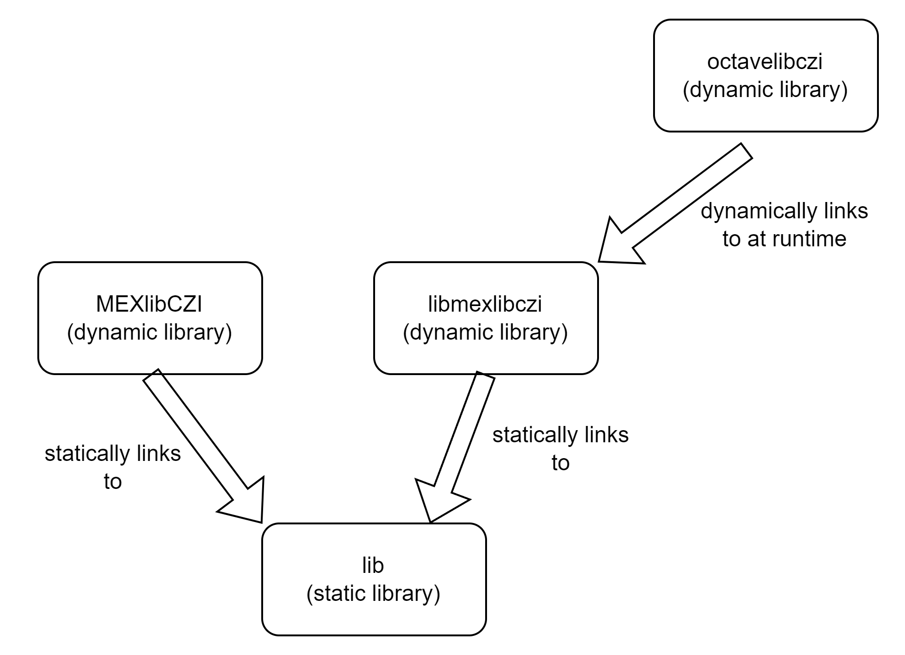

# Building

## General Remarks

In this project, mex-files for MATLAB and Octave are built. Those mex-files are built using the respective
environments (i.e. a MATLAB or Octave installation, providing the required headers and libraries).   
Note that the actual binaries are specific to the MATLAB or Octave. I.e. it is not possible to use the mex-file
build for Octave with MATLAB, and vice versa.  
The mex-file for MATLAB is built with the CMake build system, while the mex-file for Octave is built from
within Octave itself.

* The actual implementation is found in a static library "lib". This does not directly call any mex-functions, but
   uses an interface.
* For MATLAB, the project MEXlibczi is a dynamic libary, linking to the MATLAB mex-library (and is providing an interface
   implementation with it) and the static library "lib". It is self-contained.
* For Octave, we build a dynamic library "libmexlibczi" which contains the static "lib" library. Then we build
   a mex-file "octavelibczi", which is merely a stub and at runtime loads the dynamic library "libmexlibczi".

This way, the code for MATLAB and Octave is shared, but the build process is different.

]

## CMake

Executing the following command in the root directory of the project will build the mex-file for MATLAB   
and the dynamic library for the Octave-mex-file:

```bash
mkdir build
cd build
cmake ..
cmake --build . -j
```

The CMake build system will try to located the MATLAB installation automatically. It is also possible to specify the paths for the folders containing the necessary headers and libraries
manually. This can be done by setting the CMake variables `MEXLIBCZI_HEADERS` and `MEXLIBCZI_LIBS`.

## Building the Octave mex-file

The Octave-mex-file is built from within Octave itself. The following commands are executed in the root directory of the project:

```bash
cd D:\dev\MyGitHub\MEXlibCZI\OctaveMex
mkoctfile --mex octavelibczi.c
```

This will create the mex-file "octavelibczi.mex" in the current directory. This mex-file is a stub and at runtime loads the dynamic library "libmexlibczi".  
For the Octave-mex-file to work, the dynamic library "libmexlibczi" must be present in the same directory. This library is built using CMake, and must be copied 
manually to the directory where the mex-file is located.

## macOS Apple Silicon

Use a native Apple Silicon MATLAB installation and Xcode command-line tools. The CI build targets
macOS 15 or later and produces `MEXlibCZI.mexmaca64`:

```bash
cmake -S . -B build -DCMAKE_BUILD_TYPE=Release -DCMAKE_OSX_ARCHITECTURES=arm64 -DCMAKE_OSX_DEPLOYMENT_TARGET=15.0
cmake --build build --parallel
```

If MATLAB is not found automatically, pass `-DMatlab_ROOT_DIR=/Applications/MATLAB_R2026b.app`
using the path to your installation. For the manual headers/libraries override, macOS uses
`libmex.dylib` and `libmx.dylib` from MATLAB's `bin/maca64` directory.

For Octave, install native Octave with `brew install octave`, build the CMake targets above
(or set `-DMEXLIBCZI_BUILD_MATLABMEX=OFF` if MATLAB is unavailable), then run:

```bash
cd OctaveMex
mkoctfile --mex octavelibczi.c
cp ../build/libmexlibczi/libmexlibczi.dylib .
```

Keep `octavelibczi.mex` and `libmexlibczi.dylib` together. The Octave wrapper is built against
Homebrew Octave and requires a compatible native Octave installation and its runtime dependencies.
The MATLAB binary is for native Apple Silicon MATLAB, not Intel MATLAB running under Rosetta.
