The following commands are available in the mex file.

| Command | Description |
| --- | --- |
| [GetVersion](#getversion) | Returns the version of the MEXlibCZI mex file. |
| [Open](#open) | Open a CZI file and return a handle to the document. |
| [GetSubBlockBitmap](#getsubblockbitmap) | Read the specified subblock and get the (uncompressed) bitmap. |
| [GetInfo](#getinfo) | Get information about the specified CZI-document. |
| [GetScaling](#getscaling) | Retrieve scaling information from the specified document. |
| [GetMultiChannelScalingTileComposite](#getmultichannelscalingtilecomposite) | Get a multi-channel composite image from the specified axis-aligned ROI with the specified zoom. |
| [GetSingleChannelScalingTileComposite](#getsinglechannelscalingtilecomposite) | Get a tile-composite for the specified region-of-interest for the specified plane with the specified zoom-factor. |
| [GetMetadataXml](#getmetadataxml) | Get the metadata of the specified CZI-document as an XML string. |
| [Close](#close) | Close the document and free the resources. |
| [GetDefaultDisplaySettings](#getdefaultdisplaysettings) | Get the display-settings from the CZI-document.  |
| [GetSubBlock](#getsubblock) | Get a handle to a subblock (and return a handle to it).  |
| [GetInfoFromSubBlock](#getinfofromsubblock) | Get information about a subblock. |
| [GetBitmapFromSubBlock](#getbitmapfromsubblock) | Get the bitmap of a subblock.  |
| [GetMetadataFromSubBlock](#getmetadatafromsubblock) | Get the metadata from a subblock. |
| [ReleaseSubBlock](#releasesubblock) | Releases a handle for a subblock. |
| [QuerySubBlockDirectory](#querysubblockdirectory) | Get information about all (or a filtered subset of the) subblocks without reading them. |
| [CreateCziWriter](#createcziwriter) | Creates a writer object (for writing a CZI document) and returns a handle to it. |
| [AddSubBlock](#addsubblock) | Adds a subblock to the writer object.|
| [CloseCziWriter](#closecziwriter) | Closes a writer object and finalizes the CZI-document. |

## GetVersion

The function returns a struct containing version information. It does not take any arguments.
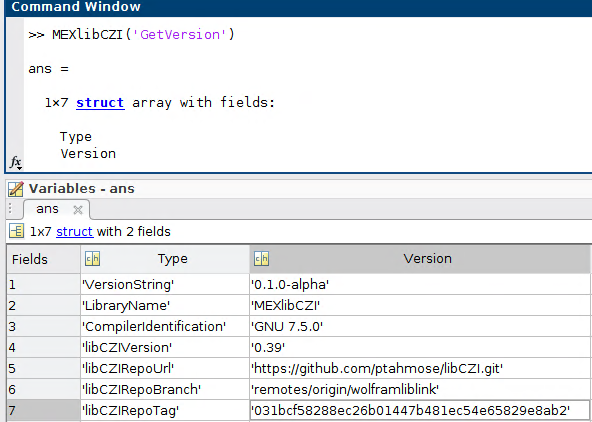

## Open

The specified file (second argument) is opened, and a handle for the document is returned.
An optional third argument supplies libCZI reader open options as a character string
of semicolon-separated `key=value` pairs:

```matlab
h = MEXlibCZI('Open', 'sample.czi', 'dimensionSwapWorkaround=XtSubblocks');
```

Omitting this argument or passing `''` uses libCZI's default open options.
Unspecified options retain their defaults. Keys and values are case-sensitive.
Unknown keys are ignored by libCZI; invalid syntax or values produce an error.
The same optional argument is supported by `octavelibczi`.

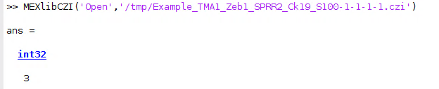

## GetSubBlockBitmap

| argument # | type    | comment                              |
| :--------- | :------ | :----------------------------------- |
| 1          | integer | The handle (as returned from "Open") |
| 2          | integer | The subblock number                  |

Read the specified subblock and get the (uncompressed) bitmap.

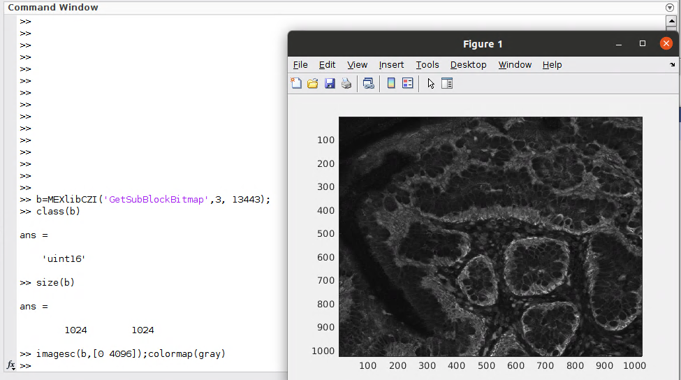

## GetInfo

Get information about the specified CZI-document. A struct is returned.

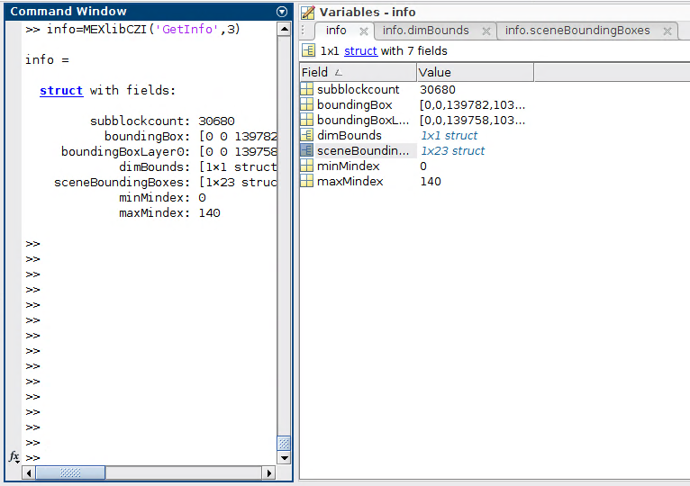
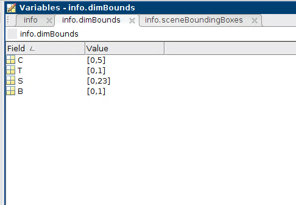
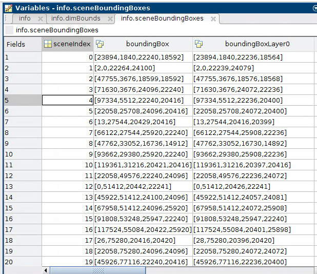

## GetScaling

Retrieve scaling information from the specified document. The scaling is given in units of µm. 
If no information is available, the property will have the value of NaN.

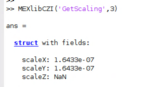

## GetMultiChannelScalingTileComposite

Get a multi-channel composite image from the specified axis-aligned ROI with the specified zoom.

| argument # | type            | comment                              |
| :--------- | :-------------- | :----------------------------------- |
| 1          | integer         | The handle (as returned from "Open") |
| 2          | array of numbers| The coordinates of the ROI           |
| 3          | string          | The plane coordinate                 |
| 4          | number          | The zoom                             |

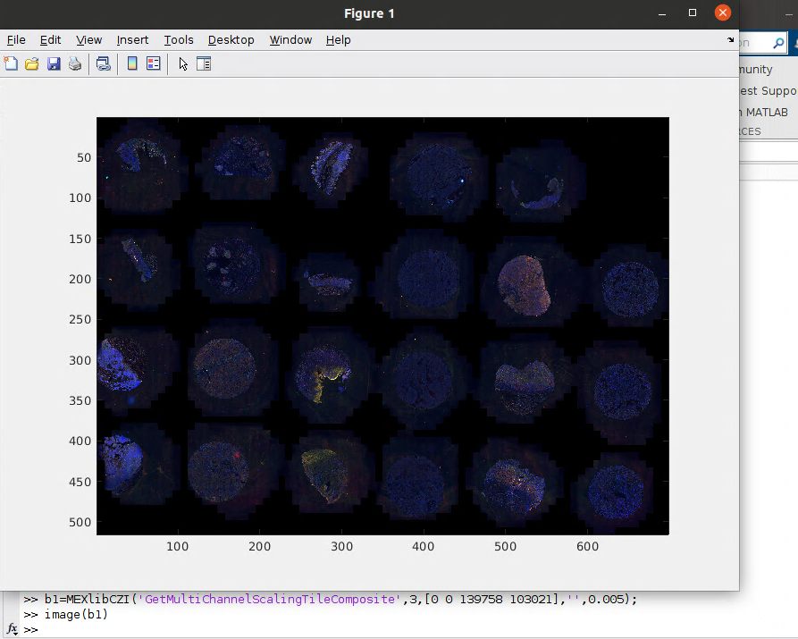


## GetSingleChannelScalingTileComposite

Get a tile-composite for the specified region-of-interest for the specified plane with the specified zoom-factor.
zoom is a number between 1 and 0, and the pixel-size of the resulting image will be zoom * w and zoom * h.

| argument # | type            | comment                              |
| :--------- | :-------------- | :----------------------------------- |
| 1          | integer         | The handle (as returned from "Open") |
| 2          | array of numbers| The coordinates of the ROI           |
| 3          | string          | The plane coordinate                 |
| 4          | number          | The zoom                             |

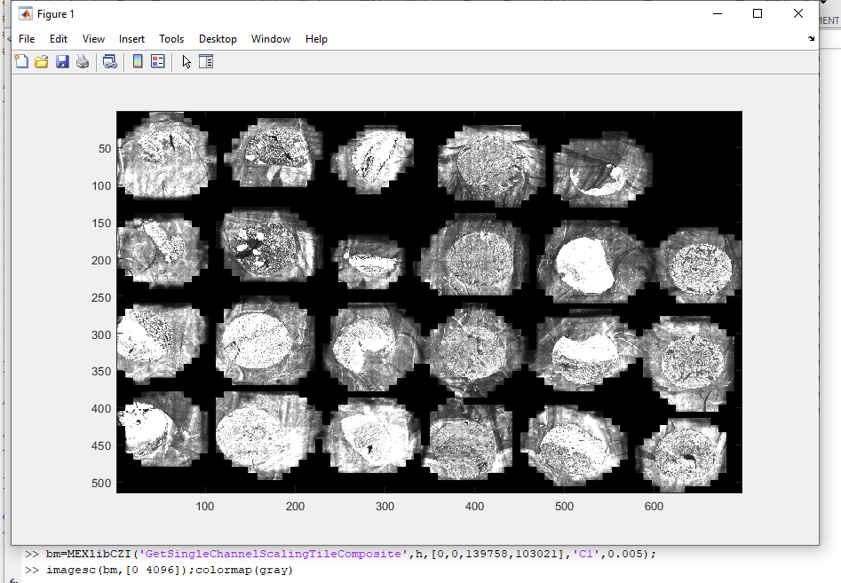

## GetMetadataXml

Get the metadata of the specified CZI-document as an XML string.

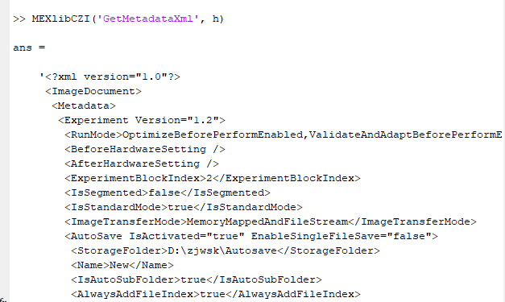

## Close

Close the document and free the resources. The handle is no longer valid.

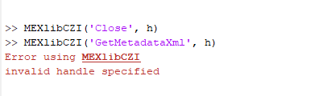

## GetDefaultDisplaySettings

Get the display-settings from the CZI-document. The function returns a struct.

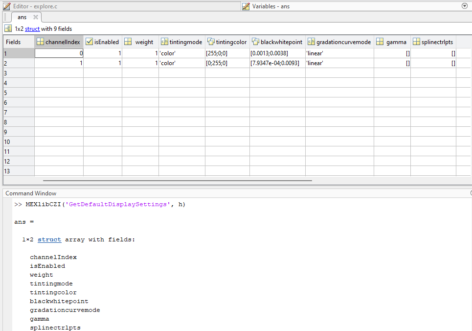

## GetSubBlock

Get a handle to a subblock (and return a handle to it).

| argument # | type            | comment                              |
| :--------- | :-------------- | :----------------------------------- |
| 1          | integer         | The handle (as returned from "Open") |
| 2          | integer         | The subblock number                  |

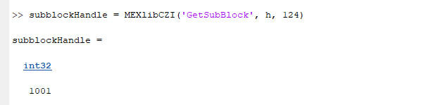

## GetInfoFromSubBlock

Get information about a subblock. The function returns a struct.

| argument # | type            | comment                                              |
| :--------- | :-------------- | :--------------------------------------------------- |
| 1          | integer         | The handle (as returned from "Open")                 |
| 2          | integer         | The subblock handle (as returned from "GetSubBlock"  |

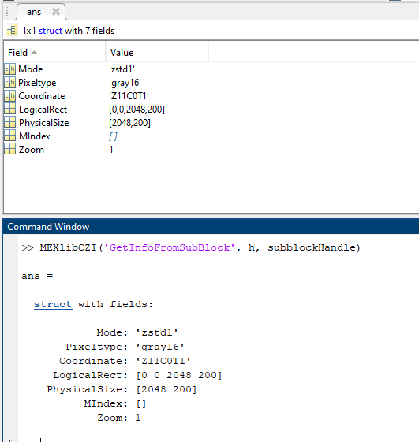

## GetBitmapFromSubBlock

Get the bitmap from the specified subblock. The subblock is decompressed (if necessary) and the bitmap is returned.

| argument # | type            | comment                                              |
| :--------- | :-------------- | :--------------------------------------------------- |
| 1          | integer         | The handle (as returned from "Open")                 |
| 2          | integer         | The subblock handle (as returned from "GetSubBlock"  |

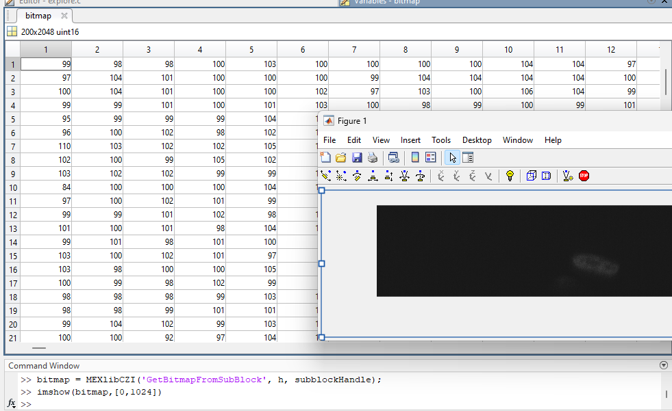

## GetMetadataFromSubBlock

Get the XML-metadata from the specified subblock. 

| argument # | type            | comment                                              |
| :--------- | :-------------- | :--------------------------------------------------- |
| 1          | integer         | The handle (as returned from "Open")                 |
| 2          | integer         | The subblock handle (as returned from "GetSubBlock"  |


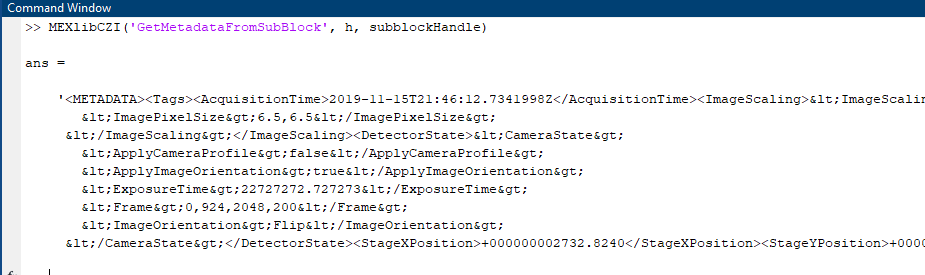

## ReleaseSubBlock

Releases a subblock handle. The handle is no longer valid, and the resources are freed.

## QuerySubBlockDirectory

Queries the subblock directory of the document and returns information about the subblocks, optionally restricted to a subset
(like the "EnumSubset"-operation in libCZI). The subblock directory is held in memory, so this operation does not read any 
subblock from the file. It is the efficient way to find out which subblocks exist (e.g. for a given plane), and the returned
`Index` can then be used with "GetSubBlock" (or "GetSubBlockBitmap") to read the subblock.

| argument # | type              | comment                                              |
| :--------- | :---------------- | :--------------------------------------------------- |
| 1          | integer           | The handle (as returned from "Open")                 |
| 2          | struct (optional) | The filter, selecting the subblocks to be returned. If omitted, all subblocks are returned. |

The following (all optional) fields of the filter struct are available:

| Field          | type                        | Description |
| :-----         | :---                        | :--- |
| "Coordinate"   | struct                      | Restricts the result to subblocks with the specified coordinates. For each dimension (`Z`, `C`, `T`, `R`, `S`, `I`, `H`, `V`, `B`) a field can be given, which is either a single integer *n* (selects that value) or `[start size]` (selects the values *start* to *start+size-1*; *size* must be greater than 0). This is the same representation as used for dimension bounds elsewhere (e.g. in "GetInfo"). The subblock's coordinate must lie in the interval for each dimension given; a subblock without the queried dimension does not fail the filter; the dimension is simply ignored for that subblock. Dimensions not mentioned are not restricted. Values must be integral (fractional values are an error). Example: `struct('C', 0, 'Z', [2 2])` selects channel 0 and Z-planes 2 and 3. |
| "Roi"          | array of 4 numbers          | `[x y width height]`. Only subblocks whose logical rectangle intersects this region are returned. |
| "OnlyLayer0"   | logical                     | If true, only subblocks of pyramid-layer 0 are returned. Default is false. |

The function returns a struct of arrays. All arrays have one row per returned subblock (N rows), and row *i* of each field describes the same subblock.
**The order of the subblocks is not specified** - in particular, it is not guaranteed to be sorted by index or by coordinate, and it can differ between
different queries. Use `Index` to identify a subblock.

| Field                  | type / size    | Description |
| :-----                 | :---           | :--- |
| "Index"                | int32, Nx1     | The index of the subblock (the number to be used with "GetSubBlock" and "GetSubBlockBitmap"). |
| "Mode"                 | uint8, Nx1     | The compression mode (numeric code, see below). |
| "Pixeltype"            | uint8, Nx1     | The pixel type (numeric code, see below). |
| "CoordinateDimensions" | char, 1xD      | The dimensions present in at least one subblock in the document, in the order `ZCTRSIHVB`, e.g. `'ZCT'`. This is independent of the filter, including when no subblocks match. |
| "Coordinate"           | int32, NxD     | Column *j* contains the coordinate for the dimension given by the *j*-th character of "CoordinateDimensions". For a subblock which does not have this dimension, the value is `intmin('int32')`. |
| "LogicalRect"          | int32, Nx4     | `[x y width height]` of the subblock's logical rectangle. |
| "PhysicalSize"         | int32, Nx2     | `[width height]` of the subblock's bitmap. The zoom factor can be calculated from "LogicalRect" and "PhysicalSize". |
| "MIndex"               | int32, Nx1     | The M-index. If the subblock does not have a valid M-index, the value is `intmin('int32')`. |

The numeric codes for "Pixeltype" are:

| Code | Pixel type |
| :--- | :--- |
| 0 | Gray8 |
| 1 | Gray16 |
| 2 | Gray32Float |
| 3 | Bgr24 |
| 4 | Bgr48 |
| 8 | Bgr96Float |
| 9 | Bgra32 |
| 10 | Gray64ComplexFloat |
| 11 | Bgr192ComplexFloat |
| 12 | Gray32 |
| 13 | Gray64Float |
| 255 | Invalid |

The numeric codes for "Mode" are:

| Code | Compression |
| :--- | :--- |
| 0 | Uncompressed |
| 1 | JPG |
| 4 | JPG-XR |
| 5 | Zstd0 |
| 6 | Zstd1 |
| 7 | ChunkedExtensible |
| 255 | Invalid |

Example - read all subblocks of channel 0:

```matlab
d = MEXlibCZI('QuerySubBlockDirectory', handle, struct('Coordinate', struct('C', 0)));
for k = 1:numel(d.Index)
    bitmap = MEXlibCZI('GetSubBlockBitmap', handle, d.Index(k));
end
```

## CreateCziWriter

Creates a writer object (for writing a CZI document) and returns a handle to it.

| argument # | type              | comment                                              |
| :--------- | :---------------- | :--------------------------------------------------- |
| 1          | string            | The filename.                                        |
| 2          | string (optional) | Options for creating the file.                       |

For the argument 2, the following options are available:

| Option | Description |
| --- | --- |
| "overwrite" or 'x' | Overwrite the file if it exists. |

The function returns a handle to the writer object.

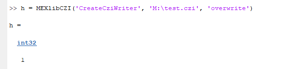

## AddSubBlock

Adds a subblock to the writer object.

| argument # | type              | comment                                              |
| :--------- | :---------------- | :--------------------------------------------------- |
| 1          | integer           | The handle (as returned from "CreateCziWriter")      |
| 2          | string            | The coordinate of the subblock (in a string represenation).     |
| 3          | array of numbers  | The coordinates of the logical ROI |
| 4          | string            | The pixel type|
| 5          | 2d or 3d array of numbers  | The bitmap to be written into the subblock |
| 6          | struct (optional) | property bag with options for the operation |

The following pixel types are available (for argument #4):

| Pixel type | Description |
| --- | --- |
| "gray8" | 8-bit grayscale |
| "gray16" | 16-bit grayscale |
| "bgr24" | 8-bit BGR color |

The following options are available (for argument #6):

| Option         | type    | Description |
| :-----         | :---    | :--- |
| "M"            | integer | The value of the M-index |
| "metadata_xml" | string  | XML metadata to be written to the subblock |
| "compression"  | string  | A string describing the compression to be used for the bitmap. The syntax is as defined [here](https://zeiss.github.io/libczi/classlib_c_z_i_1_1_utils.html#a4cb9b660d182e59a218f58d42bd04025). |

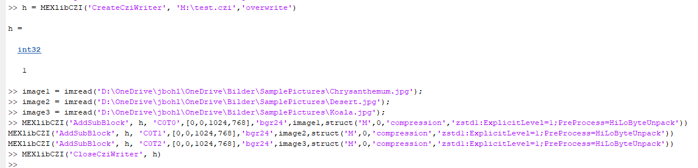

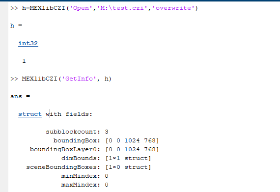

## CloseCziWriter

Closes a writer object and finalizes the CZI-document.
